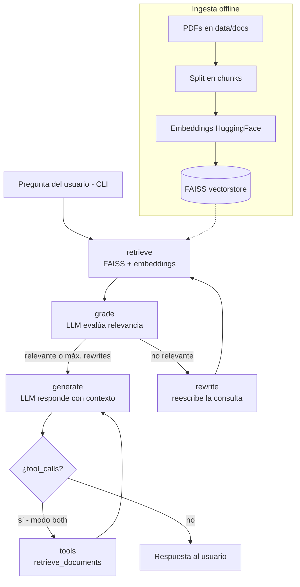

# Langgraph-ReAct-Agent

Pipeline Corrective RAG (Retrieval-Augmented Generation) construido con LangGraph, con patrón ReAct, búsqueda vectorial FAISS, ingesta de documentos y una CLI interactiva.

[](https://python.org)
[](LICENSE)

## Contenido

- [Características](#características)
- [Arquitectura](#arquitectura)
- [Stack](#stack)
- [Estructura del repositorio](#estructura-del-repositorio)
- [Instalación](#instalación)
- [Uso](#uso)
- [Configuración](#configuración)
- [Tests](#tests)
- [Roadmap](#roadmap)
- [Licencia](#licencia)

## Características

- Pipeline **Corrective RAG** sobre LangGraph con tres modos configurables vía `RAG_MODE`:
  - `none` — agente ReAct puro con tool de retrieval.
  - `auto` — pipeline RAG `retrieve → grade → rewrite → generate`.
  - `both` — pipeline RAG + tool de refinamiento (por defecto).
- Ingesta de PDFs desde `data/docs` y chunking configurable (`RecursiveCharacterTextSplitter`).
- Indexación vectorial con **FAISS** y embeddings de HuggingFace (por defecto `intfloat/e5-small`).
- LLM compatible con la API de OpenAI (OpenAI, Ollama y otros endpoints `OPENAI_BASE_URL`).
- Re-escritura automática de la consulta cuando los documentos recuperados no son relevantes (máximo configurable).
- Checkpointer de memoria (RAM) o **SQLite** para persistir conversaciones por `thread_id`.
- CLI interactiva con streaming de tokens y comandos `/new`, `/history`, `/clear`, `/mode`, `/help`, `/exit`.

## Arquitectura



- **Modo `none`**: el grafo es `agent ⇄ tools` (ReAct clásico con `ToolNode`).
- **Modo `auto`**: `retrieve → grade → rewrite/generate` sin nodo de herramientas.
- **Modo `both`**: añade el nodo `tools` al ciclo de generación (refinamiento opcional).

## Stack

- **Lenguaje**: Python 3.12+ (`requires-python = ">=3.12"`).
- **Orquestación**: LangGraph, LangChain (`langchain`, `langchain-community`, `langchain-huggingface`, `langchain-openai`).
- **Vector store**: FAISS (`faiss-cpu`).
- **Embeddings / LLM**: sentence-transformers / HuggingFace, clientes OpenAI-compatible.
- **Documentos**: pypdf.
- **Configuración**: pydantic-settings + python-dotenv.
- **Calidad**: pytest, ruff.

## Estructura del repositorio

```
Langgraph-ReAct-Agent/
├── app/
│   ├── __init__.py
│   ├── cli.py
│   ├── config.py
│   ├── embeddings.py
│   ├── graph.py
│   ├── ingest.py
│   ├── llm.py
│   ├── logging_config.py
│   ├── models.py
│   ├── nodes.py
│   ├── retriever.py
│   └── tools.py
├── tests/
│   ├── __init__.py
│   ├── test_embeddings.py
│   ├── test_graph.py
│   ├── test_retriever.py
│   └── test_smoke.py
├── test_embeddings.py
├── requirements.txt
├── pyproject.toml
├── .env.sample
└── LICENSE
```

## Instalación

```bash
git clone https://github.com/bi0punk/Langgraph-ReAct-Agent.git
cd Langgraph-ReAct-Agent
python -m venv .venv && source .venv/bin/activate
pip install -r requirements.txt
# o, con extras de desarrollo y console script:
pip install -e ".[dev]"
```

La instalación con `.[dev]` registra el console script `langgraph-rag` (`app.cli:main`).

## Uso

```bash
# 1. Configurar entorno
cp .env.sample .env

# 2. Ingestar los PDFs que estén en data/docs
python -m app.ingest

# 3. Iniciar la CLI interactiva
python -m app.cli
# o, si se instaló el paquete:
langgraph-rag
```

Comandos dentro de la CLI: `/new`, `/history`, `/clear`, `/mode`, `/help`, `/exit`.

## Configuración

Variables de entorno (ver `.env.sample`, cargadas por `app/config.py`):

| Variable            | Default                        | Descripción                                              |
|---------------------|--------------------------------|----------------------------------------------------------|
| `OPENAI_API_KEY`    | —                              | API key del proveedor LLM (OpenAI-compatible)            |
| `OPENAI_MODEL`      | `gpt-4o-mini`                  | Modelo LLM                                               |
| `OPENAI_BASE_URL`   | (vacío)                        | Base URL (p. ej. `http://localhost:11434/v1` para Ollama) |
| `EMBEDDING_MODEL`   | `intfloat/e5-small`            | Modelo de embeddings de HuggingFace                      |
| `DOCS_PATH`         | `data/docs`                    | Directorio de PDFs de entrada                            |
| `VECTORSTORE_PATH`  | `vectorstore/faiss_index`      | Ruta del índice FAISS persistido                         |
| `RAG_TOP_K`         | `4`                            | Documentos recuperados por consulta                      |
| `RAG_CHUNK_SIZE`    | `1000`                         | Tamaño de chunk                                          |
| `RAG_CHUNK_OVERLAP` | `150`                          | Solapamiento entre chunks                                |
| `RAG_MODE`          | `both`                         | `none`, `auto` o `both`                                  |
| `MAX_REWRITES`      | `2`                            | Máximo de re-escrituras de query                         |
| `CHECKPOINTER`      | `memory`                       | `memory` o `sqlite`                                      |
| `CHECKPOINT_DB`     | `data/checkpoints.sqlite`      | Ruta de la DB de checkpoints (si `sqlite`)               |
| `LOG_LEVEL`         | `INFO`                         | Nivel de logging                                         |
| `THREAD_ID`         | `cli-session-1`                | Identificador de hilo/conversación inicial              |

## Tests

```bash
pip install -e ".[dev]"
pytest -q
ruff check .
```

No hay workflow de CI en `.github/workflows` para este repositorio.

## Roadmap

- [ ] Soporte para más fuentes de datos (web scraping, APIs).
- [ ] Evaluación de calidad de retrieval (MRR, NDCG).
- [ ] Interfaz web con Streamlit.
- [ ] Auto-refresh de índices con nuevos documentos.

## Licencia

MIT — ver [LICENSE](LICENSE).
